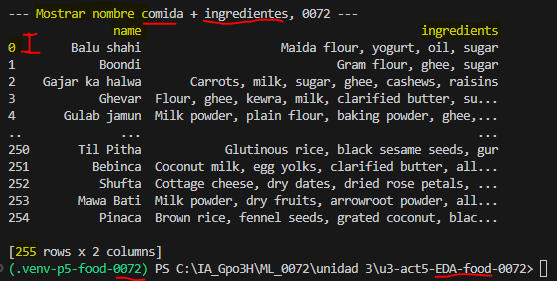
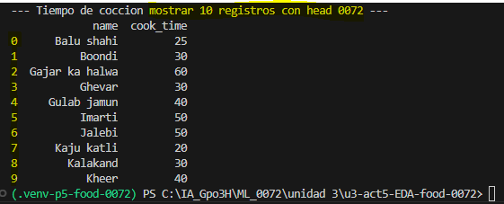
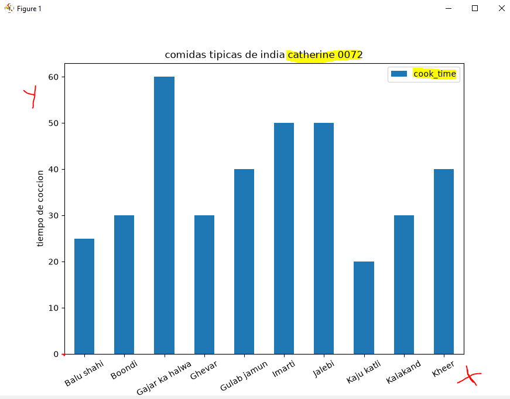
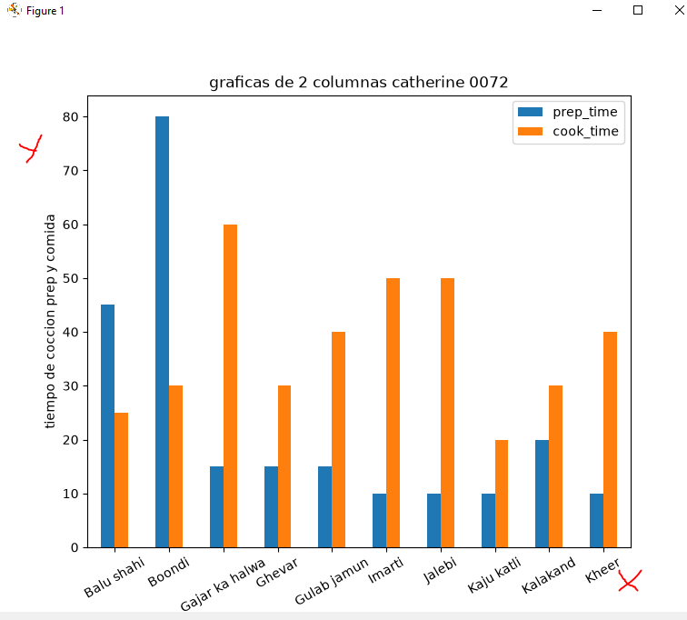
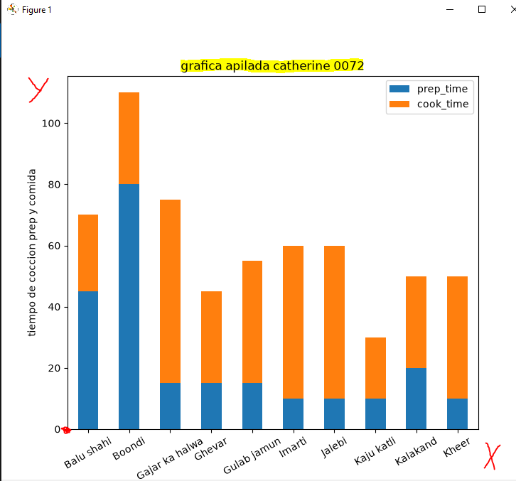

## Anlisis exploratorio de datos
## Comida del pais India 
## Catherine rascon NC = 0072
### +-+-+-+- Importación de datos del archivo csv comida de india -+-+-+-+

### +-+-+-+- Mostrar nombre comida + ingredientes -+-+-+-+

### +-+-+-+- Tiempo de coccion mostrar 10 registros con head +-+-+-+-

### creacion de graficas de barras 0072

### gráfica de varias columnas

### grafica apilada

### Personalización de gráficos de barras en Pandas

